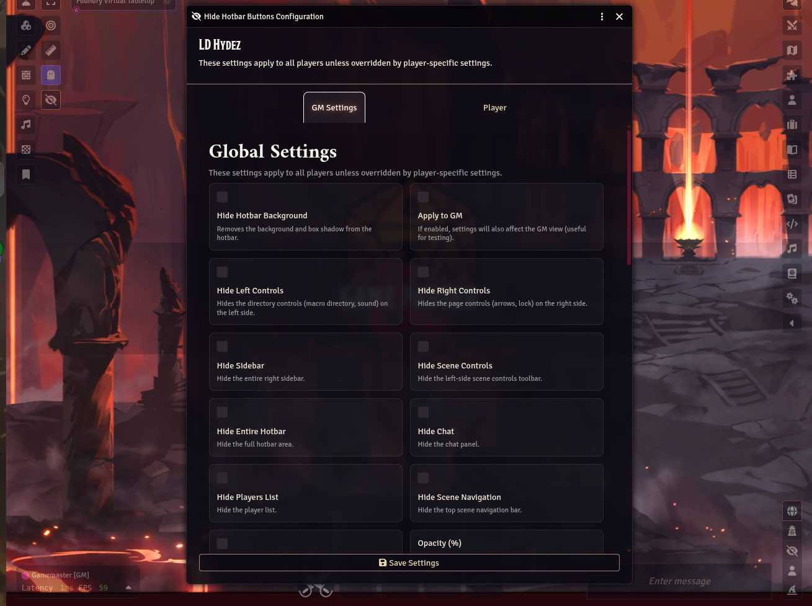
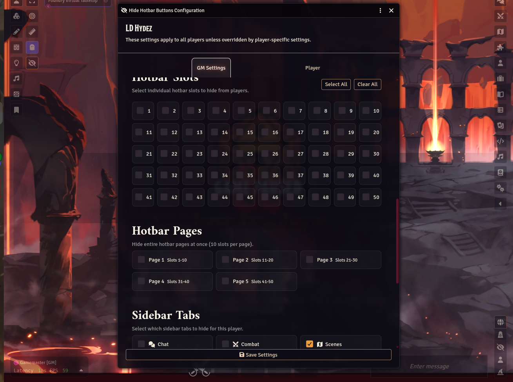
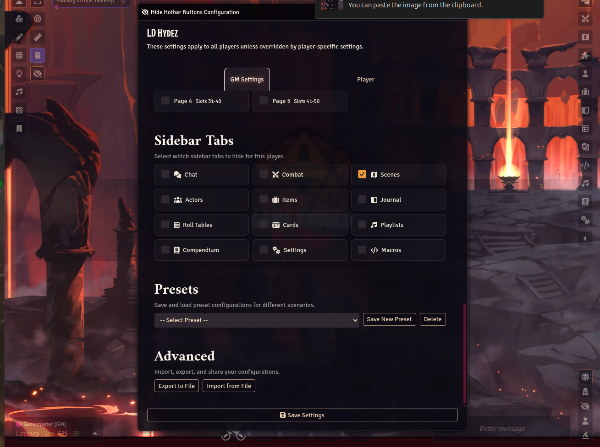
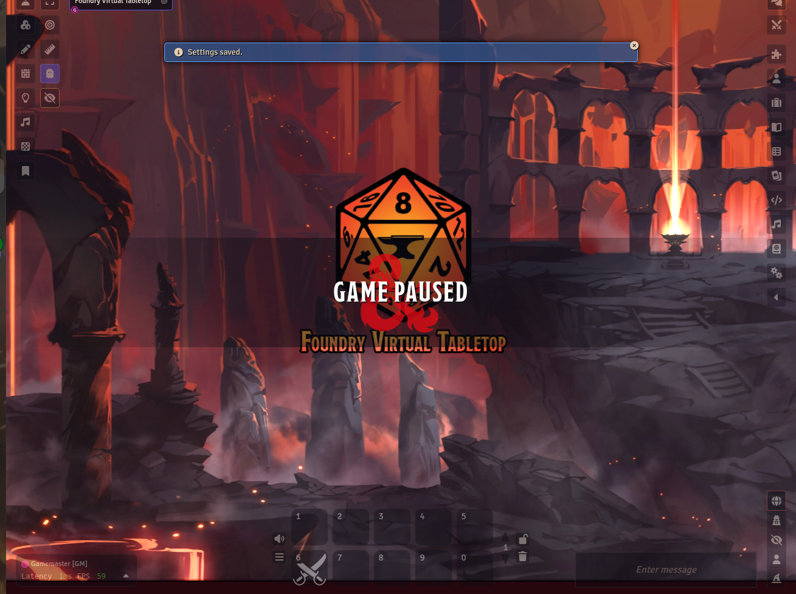

# LD Hydez

Hotbar customization for Foundry Virtual Tabletop with per-user visibility rules, presets, opacity controls, and animated interface hiding.

## Screenshots

| Global (GM) settings | Hotbar slots & pages |
| --- | --- |
|  |  |

| Sidebar tabs, presets & import/export | In-game |
| --- | --- |
|  |  |

## Features

- Hide individual hotbar slots
- Hide entire hotbar pages
- Hide left and right hotbar controls
- Hide sidebar, chat, players list, and scene navigation
- Apply visibility rules globally or per player
- Save, load, export, and import presets
- Adjust opacity and animation duration

## Compatibility

- Foundry Virtual Tabletop: v13+ (verified v14)
- Scope: system agnostic

## Installation

1. Open **Add-on Modules** in Foundry VTT.
2. Choose **Install Module**.
3. Paste the manifest URL:

   ```text
   https://raw.githubusercontent.com/lisasdungeon/ld-hydez/main/module.json
   ```

4. Install the module and enable it for your world.
5. Open the module configuration to choose global and per-player visibility rules.

## Usage

1. Open the **Hide Hotbar Buttons** configuration from module settings.
2. Configure global visibility defaults.
3. Override those defaults for specific non-GM users if needed.
4. Save presets for recurring layouts.
5. Export or import configuration JSON when moving settings between worlds.

## Support

- GitHub: https://github.com/lisasdungeon/ld-hydez
- Patreon: https://patreon.com/LisasDungeon
- Discord: MystryssLysa
- Email: Lisasdungeon@gmail.com

## License

MIT License. See `LICENSE`.
